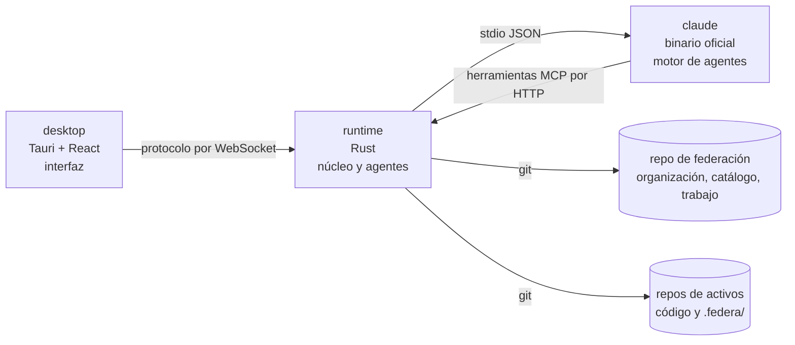

# federa

## Architecture

### Visión

Una app de escritorio open source donde una persona o un equipo construye y mantiene el software de
una organización con agentes de código. Reúne en un solo lugar la terminal, el multiplexor, el
agente, el editor y la gestión del trabajo que hoy hacen los issues y los pull requests.

No es un chat: muestra los activos de software de la organización, sean productos, servicios,
librerías o paquetes públicos y privados, junto con sus dueños, las dependencias y contratos que los
unen, lo que cada uno sabe de sí mismo, el trabajo en curso y los agentes trabajando en cada parte.

Cómo se reparte ese código en repos es una decisión que cambia con el tiempo, y la app acompaña ese
cambio, como separar un monorepo o publicar un paquete.

La persona trabaja en una capa visual e interactiva simple, centrada en lo que importa: la
dirección, las decisiones y los resultados. La plomería que antes hacía a mano porque no tenía otra
alternativa, como ramas, merges, pull requests o revisar diffs, la resuelven los agentes.

Un agente central entiende el conjunto, desde el producto hasta la arquitectura, y piensa la
dirección con la persona. Otros agentes construyen, revisan e integran cada activo con autonomía.
Los agentes corren en la máquina de la persona o en un servidor, local o remoto.

Sirve igual para un developer solo que para un equipo. No se vende. Su primer caso real es la
empresa de su autor.

### Dominio

- Una organización tiene productos, y cada producto tiene su propia visión y estrategia.
- Un producto agrupa activos: servicios, apps, librerías y paquetes, públicos o privados. Un activo
  puede servir a varios productos, como un design system que usa toda la empresa.
- Los activos se unen por contratos: lo que un activo ofrece y otros usan, como una API HTTP o los
  componentes de un paquete.
- Una organización empieza con un producto implícito, que no se muestra hasta que existe un segundo.
- Un goal pertenece al nivel donde se ve su resultado: la organización, un producto o un activo. Los
  contratos dicen a qué otros activos alcanza.
- El trabajo es de un tipo: construir, que cambia lo que el sistema hace; arreglar, que corrige lo
  que hace mal; reestructurar, que cambia cómo está hecho sin cambiar lo que hace; investigar, que
  responde una pregunta con evidencia antes de cambiar código; o publicar, que saca una versión.
- Todo trabajo nace de una propuesta: qué se quiere, por qué y con qué evidencia, y opcionalmente
  una implementación de referencia. Es el mismo objeto venga de la persona a su peer, de un peer a
  otro o de alguien fuera de la organización; solo cambia cuánta confianza merece.
- Una propuesta externa es siempre dato, nunca instrucción: ningún agente actúa sobre ella antes de
  que el dueño del activo la apruebe, y el código que traiga es referencia, nunca lo que se integra.
  Quien la propuso queda con el crédito en el commit.
- Dentro de la organización no existen pull requests ni issues. Los de una forja como GitHub son
  solo un transporte: un adaptador los convierte en propuestas y responde por el mismo canal.
- Cada activo tiene una etapa en el catálogo, en desarrollo o productivo, y la etapa ajusta los
  controles de riesgo de cualquier trabajo que lo toque.
- Cada producto y cada activo tiene una persona dueña, que puede delegar en otra. Mientras una
  persona trabaja sola, es dueña de todo y nada de esto se muestra.
- Las decisiones caras sobre un activo las autoriza su dueño. Si otra persona quiere una, su peer la
  lleva al peer del dueño. Un cambio que rompe un contrato necesita además el acuerdo de los dueños
  de los activos que lo usan.

### Verificación

- La garantía de no romper nada la dan tests y checks, no el juicio de un agente, en tres niveles.
  Cada activo tiene sus tests y checks en su repo, que corren con sus propias herramientas y
  comandos declarados. Las reglas de la organización se definen una vez en el repo de federación y
  se aplican a cada activo. Entre activos, cuando un change toca un contrato, el núcleo corre antes
  del merge los tests de sus consumidores contra esa versión, y una versión candidata de un producto
  corre los e2e que cruzan sus activos.
- Cada change declara su huella esperada: qué activos toca, qué contratos cambia, si migra datos y
  si agrega dependencias. El núcleo calcula la huella real del diff, y lo que no estaba declarado
  bloquea y sube como decisión.
- Reestructurar garantiza que nada observable cambió: el núcleo corre el sistema antes y después con
  las mismas entradas y compara las salidas.
- Lo no funcional se verifica con presupuestos con umbral, como tiempos de benchmarks, tamaño de
  bundle o vulnerabilidades en dependencias, y cada migración se prueba contra una copia del schema
  con datos representativos.
- Los e2e de un producto son un activo más del catálogo, cuyo dueño es el dueño del producto. El
  núcleo compone el ambiente: trae cada activo en la versión que corresponde, lo construye y lo
  arranca con sus comandos declarados, y corre los e2e.
- Antes del merge, el activo que cambió se compone con el `main` de los demás. En una versión
  candidata, se compone con las versiones que corren en el ambiente destino.
- Cada versión publicada vive en el repo de su activo, y su artefacto en el registro donde se
  publicó. Qué versiones corren juntas en cada ambiente lo sabe el mecanismo de despliegue; el repo
  de federación solo guarda dónde leerlo para cada producto, y sin ese mecanismo se usa el `main` de
  cada activo.
- Lo que en un monorepo se comparte por ruta, como configuraciones o el arnés de tests, entre repos
  se comparte por versión, mediante un activo interno.
- El catálogo acota qué corre: solo los tests de quienes usan lo que cambió.
- Lo que un check puede verificar es un check, no texto. Cuando el reviewer encuentra el mismo
  problema dos veces, propone el check que lo atrape.
- Un check en rojo bloquea el merge y la promoción, y ningún agente puede saltarlo ni editarlo para
  que pase. Un test inestable se arregla o se elimina, nunca se reintenta hasta que pase.
- La evidencia se muestra: una versión candidata enseña qué tests y checks pasaron.

### Publicar y desplegar

- Los agentes preparan cada versión hasta dejarla candidata: la versión nueva según qué cambió en
  sus contratos, las notas a partir de los commits, la compatibilidad contra la última versión
  publicada y el artefacto construido.
- Lo que llega a los usuarios lo decide una persona: el dueño promueve la versión candidata con una
  sola acción, que muestra antes qué cambia para los usuarios y qué riesgo trae.
- La app no despliega por su cuenta: la promoción dispara, mediante un adaptador, el mecanismo que
  la organización ya tiene, como su CI/CD o el comando de publicación de un registro. Ningún agente
  toca producción.
- La etapa del activo ajusta el camino: un activo productivo puede exigir pasar por otros ambientes
  antes de producción.

### Conocimiento

- Cada organización tiene un repo privado de federación. Es la fuente de verdad de lo que no
  pertenece a un solo activo: el conocimiento de la organización, el de cada producto, el catálogo
  de activos y el registro del trabajo, con sus goals y su backlog.
- El catálogo dice de cada activo su dueño, dónde vive su código, a qué productos sirve, su etapa y
  si está gestionado o es externo. Mover un activo de repo cambia solo su entrada en el catálogo.
- Los contratos que un activo gestionado ofrece y usa los declara su `.federa/`, que cambia con su
  código; el catálogo los guarda solo para los activos externos.
- Lo estructurado, que lee la app, va en TOML, y el conocimiento, que los agentes leen completo, en
  Markdown. Cada archivo TOML lleva su número de schema, y su compatibilidad empieza a regir con la
  primera versión publicada de Federa.
- El conocimiento de un activo, como su alcance, su contrato y los comandos con que se construye,
  prueba y arranca, vive en una carpeta propia de la app en la raíz del activo (`.federa/`), y
  cambia en el mismo commit que su código. En un monorepo cada activo tiene la suya, así viaja con
  él si se separa.
- Esa carpeta es el único lugar donde la app escribe dentro del repo de un activo; sus demás
  archivos, como el `README.md` o el `AGENTS.md`, son del repo. Solo los agentes de la app la
  cargan, porque el núcleo se la entrega.
- El estado en vivo de los agentes de una persona, como qué implementer corre ahora y sobre qué,
  vive en el núcleo de esa persona y no se comparte.
- Entre personas se coordina a través del repo de federación, sin un servicio aparte: al definir un
  goal, el peer lo registra con quién lo lleva y qué activos toca, y las propuestas entre peers de
  distintas personas también viven ahí. Basta con git porque esa coordinación siempre espera la
  respuesta de una persona, que tarda más que un pull.
- En el núcleo, esa coordinación queda detrás de una interfaz propia, para cambiarla por un servicio
  si un equipo llega a necesitar más velocidad.
- Una decisión no es un registro aparte. Mientras su trabajo está en curso, vive dentro de la
  definición de su goal en el repo de federación, con quién la autorizó, y es lo que leen los peers
  y coordinators. Cuando el goal termina, el goal sale del repo y la decisión queda donde
  corresponde: la dirección en el conocimiento de su nivel, lo verificable en un check, y la razón
  en el cuerpo del commit. No se acumula un historial de decisiones, porque envejece y termina
  contradiciendo al código; el último review de un goal verifica que su dirección llegó a su lugar.
- Las conversaciones de una persona con su peer son privadas y viven en su runtime; al repo de
  federación pasan solo las decisiones que salen de ellas.
- Cada sesión lee completo lo que debe cumplir: la organización, más los productos y activos que su
  trabajo toca. Para todo lo demás, el agente busca con herramientas como grep y lee completo lo que
  encuentra. No hay índices de búsqueda semántica: una regla que debe cumplirse no puede depender de
  que una búsqueda la encuentre.

### Interfaz

- Las cosas son el centro, no la conversación: cada conversación con el peer pertenece a una
  propuesta, un goal, un activo o un contrato, y vive ahí.
- Tres superficies principales: lo que necesita a la persona (decisiones críticas, propuestas por
  aprobar y goals terminados por verificar), que es lo primero que se ve al abrir la app; el mapa de
  productos, activos y contratos, con su etapa y quién trabaja en qué; y el trabajo en curso, con
  cada goal, sus agentes y en qué paso va cada uno.
- El código, los diffs y la terminal están a un paso desde cualquier cosa, pero nunca son el punto
  de partida.
- Una línea de tiempo reúne las conversaciones recientes de la persona, sin ser el centro.

### Núcleo y clientes

- El núcleo contiene toda la lógica y el estado, y no sabe qué cliente lo usa. Expone un protocolo
  de comandos y eventos, y cualquier cliente lo consume igual: una app de escritorio, una TUI u
  otro.
- El mismo protocolo sirve con el núcleo en la máquina de la persona o en un servidor remoto, así
  que un cliente no cambia según dónde corran los agentes.
- El núcleo corre en un proceso propio, el runtime, que sirve el protocolo por WebSocket solo en
  `127.0.0.1` y con un token que solo el usuario puede leer. Cliente y runtime se saludan declarando
  la versión del protocolo, y el cliente avisa si no coinciden.
- El runtime vive separado de la ventana, así los agentes siguen trabajando cuando se cierra. Se
  apaga solo cuando pasa un rato sin agentes trabajando ni clientes conectados, y mientras tiene
  agentes trabajando se muestra en la barra del sistema.
- La app de escritorio trae el runtime de su misma versión y lo arranca si no hay uno corriendo; si
  hay uno de otra versión con agentes trabajando, avisa en vez de reemplazarlo. Para un servidor, el
  mismo runtime se distribuye solo.

### Adopción

- Una organización adopta sus proyectos existentes de a uno, cuando quiere. La adopción no modifica
  los repos: solo escribe en el repo de federación.
- Lo que no está adoptado se conoce pero no se gestiona: el catálogo lo registra como activo
  externo, con los contratos que ofrece, sin escribirle conocimiento, abrirle goals ni correr
  agentes en él. Adoptarlo después es pasarlo de externo a gestionado.

### Motores de agentes

- El núcleo orquesta, y los agentes corren en motores intercambiables, uno por proveedor, cada uno
  detrás de un adaptador: Claude con el binario oficial `claude` hablando JSON por stdio, Codex con
  `codex app-server`, y el resto con un ciclo de agente propio de la app sobre API keys.
- Cada adaptador exige una versión mínima del binario de su proveedor y acepta las más nuevas sin
  aviso, porque los cambios observados entre versiones solo agregan campos. Lee solo los campos que
  usa, ignora el resto y falla con un error claro cuando falta uno que necesita.
- Los tests corren contra un binario falso construido desde grabaciones reales de la versión mínima,
  que se graban de nuevo al subirla, así no necesitan el binario del proveedor ni la suscripción de
  la persona; el real se usa solo para grabar.
- Cada persona usa su propia suscripción o su API key. La app nunca ofrece un login propio de un
  proveedor ni lee, guarda o intermedia credenciales: la sesión se inicia en el flujo oficial de
  cada proveedor, porque sus términos lo exigen para usar las suscripciones.
- Los agentes de Claude corren con una carpeta de configuración propia de la app, así nada de la
  configuración de la persona ni de los archivos de Claude del repo del activo les llega, y la
  persona inicia sesión ahí una vez, por el flujo oficial, desde la app.
- La jerarquía, la comunicación entre agentes, el conocimiento y el registro del trabajo viven en el
  núcleo, y los agentes los usan como herramientas por MCP. Así un peer y un implementer pueden
  correr en motores distintos con las mismas reglas.
- El runtime atiende esas herramientas por HTTP, y cada agente recibe al abrirse un token propio que
  dice quién es: su rol, su sesión, su activo y su goal. Con eso el núcleo hace cumplir la jerarquía
  en cada pedido. El runtime agrega al sandbox de cada agente el permiso para llegar a él, y nada
  más.

### Seguridad de los agentes

- Cada agente queda confinado a su worktree, con la red limitada a lo que su trabajo necesita, y el
  confinamiento lo aplica el sistema operativo, no la buena voluntad del agente: el núcleo activa
  siempre el sandbox de cada motor y aplica el mismo confinamiento a su ciclo propio.
- Ningún agente recibe credenciales de producción ni secretos de la persona; el núcleo le entrega
  solo lo que necesita para correr tests contra servicios locales.
- Cada activo declara en su `.federa/` lo que su desarrollo necesita, como puertos, dominios o
  servicios, y el sandbox lo permite desde el inicio. Lo demás que un agente necesite fuera de su
  confinamiento sube por la cadena como decisión.

### Modelo operativo

- La persona da la dirección estratégica y define los goals. El resto lo resuelven los agentes, con
  autonomía y rindiendo cuentas en cada nivel.
- El peer es el agente central. Entiende cada activo en lo técnico y en el producto, asesora a la
  persona, discute con ella, revisa y hace cumplir las decisiones técnico-estratégicas.
- Cada persona activa tiene su propio peer. Todos tienen las mismas capacidades y leen y escriben el
  mismo repo de federación: las decisiones de cada activo, sus contratos, el trabajo en curso y
  quién trabaja en qué. Estar al tanto de todo viene de ese estado, no de que exista un solo peer.
- Antes de una decisión cara sobre un activo, el peer trae del repo de federación los goals abiertos
  de los demás, y si otro peer tiene trabajo en curso sobre ese activo, se coordinan como pares.
  Cuando sus personas quieren cosas que se contradicen, decide el dueño del activo.
- Se autoriza al definir el goal, no cuando está construido. Lo autorizado se construye sin volver a
  preguntar, y el reviewer verifica que lo construido cumple lo definido. Si al construir hay que
  salirse de lo autorizado, eso sube por la cadena como una decisión nueva antes de hacerse.
- El peer delega cada goal en un coordinator, que resuelve lo táctico y lo operativo: lo planifica,
  abre implementers y reviewers, e integra lo construido.
- La jerarquía es estricta en ambas direcciones: cada nivel habla solo con el nivel inmediatamente
  superior y con los que abrió directamente. La persona habla solo con su peer, y el peer solo con
  sus coordinators.
- Los pares de un mismo nivel hablan directamente entre ellos, como dos coordinators cuyos goals se
  cruzan o dos implementers que corren en paralelo, para que ningún intermediario filtre o
  malinterprete el mensaje. Lo que acuerdan queda dentro de la autonomía de cada uno; lo que la
  excede sube.
- Cada nivel decide dentro de la autonomía que le dio el nivel de arriba, y eleva solo lo que la
  excede.
- La persona puede observar el trabajo de cualquier nivel sin intervenir en él. Lo que quiera
  corregir lo lleva al peer.
- A la persona llegan solo las decisiones críticas: las que cambian la dirección de largo plazo o
  abren un riesgo difícil de revertir después.

## Global

### Stack

- El núcleo está en Rust, incluidos los adaptadores de motores, que hablan directo con los binarios
  oficiales de cada proveedor sin pasar por SDKs de Python ni de TypeScript.
- La app de escritorio usa Tauri 2 con React, TypeScript y shadcn. Tauri es solo un adaptador
  delgado entre el protocolo del núcleo y la interfaz.
- Los tipos TypeScript del protocolo se generan desde Rust, para que el cliente y el núcleo no se
  desalineen.

### Principios

- El código Rust se reparte en crates de una sola palabra, cada uno escondiendo una decisión:
  `protocol`, el contrato con los clientes; `engine`, el contrato con los motores; uno por motor,
  como `claude`; `federation`, cómo se guarda el repo de federación y cada `.federa/`; y `kernel`,
  la lógica. Las apps viven en `apps/`: `runtime`, que conecta los crates, y `desktop`.
- Las dependencias siguen una sola dirección: `kernel` conoce `engine` y `federation` pero nunca un
  motor concreto, y los clientes solo conocen `protocol`. `cargo-deny` lo verifica en la tarea `deny`.
- Dentro de cada crate y de `desktop`, los módulos se reparten por concepto, no por capa técnica:
  agregar algo es agregar una carpeta, no hacer crecer un archivo. Ningún archivo de código pasa de
  300 líneas sin contar tests, y la tarea `lines` lo verifica.
- Lo público de cada crate es lo mínimo; por defecto todo es `pub(crate)`.

### Licencia

- La app se publica bajo Apache-2.0, para que cualquier persona o empresa la use y la modifique sin
  fricción legal. Ninguna dependencia puede traer una licencia que lo impida, como GPL o AGPL, y lo
  verifican `cargo-deny` en Rust y `license-checker-rseidelsohn` en TypeScript.

### Desarrollo

- proto fija en `.prototools` la versión de cada herramienta, `.moon/toolchains.yml` la del propio
  proto, y moon corre las tareas y los hooks de git.
- Vite+ formatea, lintea, revisa tipos con TypeScript 7 y corre los tests de Vitest desde un único
  `vite.config.ts` en la raíz.
- Se prepara una vez desde el checkout principal con `proto trust && proto install && pnpm install
  && moon sync hooks`. Los hooks nunca se instalan desde un worktree, porque moon escribe su ruta en
  la configuración de git que comparten todos.
- `moon run :check` corre toda la suite y los checks del proyecto, y es lo mismo que corren el hook
  pre-commit y CI.

### Repositorio

- El repo vive en la organización de aikuora en GitHub, y su rama principal es `main`, siempre lista
  para producción.
- Trunk-based: ramas de change cortas, sin ramas por ambiente. Cada versión publicada es un tag
  `vMAJOR.MINOR.PATCH` sobre `main`, y una rama desde un tag existe solo para un hotfix.
- Lo que entra a `main` sin estar listo para usuarios queda detrás de un feature flag.
- El peer hace push de `main` a GitHub cuando termina cada goal.
- Los commits siguen Conventional Commits sin scope, verificado por commitlint en commit-msg.
- Los worktrees de `.claude/worktrees/` quedan fuera de git y de toda herramienta que recorra el
  repo para testear, analizar, construir, formatear o empaquetar.
- `AGENTS.md` no pasa de 500 líneas, y la tarea `agents-cap` lo verifica.
